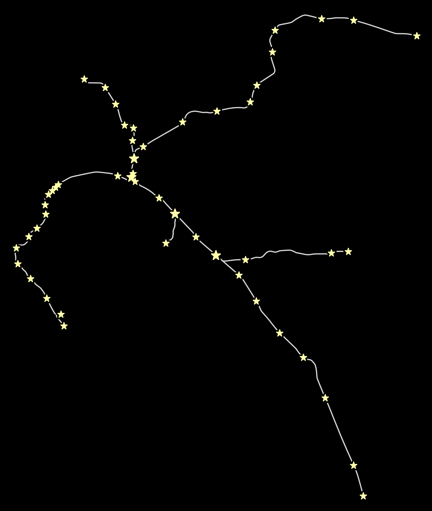

transit-star-maps
=================

transit maps that look like constellations because trains + stars = &lt;3

Buy t-shirts at [transitstarmaps.com](https://transitstarmaps.com/)
Follow us at [@transitstarmaps](https://twitter.com/transitstarmaps) and [facebook.com/transitstarmaps](https://facebook.com/transitstarmaps/)

What makes a good transit star chart?
-------------------------------------
 * The transit system needs to be complicated enough to be interesting. Sorry, [one-line systems](http://en.wikipedia.org/wiki/Link_Light_Rail) are boring.
 * Not too complicated! Sorry, [hundreds of stations and dozens of lines](http://en.wikipedia.org/wiki/New_York_City_Subway) is more complicated than any constellation. It wouldn't look right.
 * Preferably organic-looking. Systems that follow a lot of straight lines are less interesting and look less like real constellations. [This](legacy/outputs/bart_v0.2.png) is more interesting than [this](legacy/outputs/trimet_max_v0.1.png)
 * Ideally some hierarchy of stations so we can use different sizes of stars. The new pipeline draws a larger star wherever lines branch or cross.



How it works
------------

A Python pipeline turns a transit agency's GTFS feed into a constellation, in three steps:

1. **Fetch** downloads the feed once into `data/raw/<city>/` (git-ignored), with a record of the URL, the date and a SHA-256. Later builds reuse that snapshot until you ask for `--refresh`, so a map doesn't change under you because the agency published a new schedule.
2. **Network** cleans the feed into one star per station and one line per pair of neighboring stations, and saves it as `networks/<city>.geojson` (committed, so you can see in a diff exactly what changed when a feed is refreshed):
   * **Platforms and entrances** are grouped under their GTFS parent station. Station records closer than `merge_distance_m` (120 m) become one star, which handles transfer stations an agency lists twice.
   * **Lines** come from the order of stops in each trip. Every trip's shape is cut at its stations and kept once per station pair, so both directions, and every route running on a shared trunk, become a single line.
   * **Express runs** that skip stations are dropped when the local line already connects the same stations.
   * **Smoothing:** lines are simplified and lightly smoothed.
   * **Star size:** stations where three or more lines meet get a larger star. List any other station under `stations.large` in the city config (e.g. line ends or landmark stations) to give it one too; this takes effect at render time, without rebuilding the network.
   * **Dense cores:** in a city with a crowded downtown (Portland, LA), `style.min_star_spacing_in` combines stars that would overlap on the page into one.
3. **Render** writes `outputs/<city>/<city>_black.svg` and `<city>_transparent.svg`, plus PNGs of each, sized for printing (10 in wide at 300 dpi by default, with the dpi recorded in the PNG). The lines are cut away around every star with an SVG mask rather than a black outline, so the transparent version needs no Photoshop work.

Each city has a config in `cities/<city>.yaml`. Anything the code doesn't decide on its own goes there: the feed URL, which routes to include, stations to merge, drop or resize, rotation, page size, star and line sizes, and colors. `starmaps/config.py` lists every setting with its default.

Setup
-----

Python 3.11+.

```sh
python -m venv .venv
.venv/bin/pip install -r requirements.txt
.venv/bin/playwright install chromium   # or set CHROME_PATH to an existing Chrome/Chromium
```

Usage
-----

```sh
.venv/bin/python -m starmaps build bart          # fetch + network + render
.venv/bin/python -m starmaps fetch bart --refresh  # get the agency's latest feed
.venv/bin/python -m starmaps render all --no-png # just the SVGs, every city
make all          # every current city
make compare      # rebuild the 2016-data maps and outputs/compare_legacy.png
make test
```

| City config | Source | Lines |
|---|---|---|
| `bart` | BART GTFS | all BART, including eBART and the Oakland Airport connector |
| `la_metro` | LA Metro rail GTFS | A, B, C, D, E, K |
| `trimet_max` | TriMet GTFS | MAX only (no streetcar or WES) |
| `bc_skytrain` | TransLink GTFS | Expo, Millennium, Canada |
| `toronto` | TTC GTFS | Lines 1, 2, 4, 5, 6. Not built yet: in Nov 2026 Toronto Open Data was serving an empty zip for this feed |
| `montreal` | STM GTFS | Métro (green, orange, yellow, blue). STM's route shapes are very coarse, so the lines are nearly straight between stations |
| `seattle_link` | Sound Transit rail GTFS | Link 1 Line and 2 Line (not the T Line or Sounder) |
| `boston_mbta` | MBTA GTFS | Red (with Mattapan), Orange, Blue, Green (with the Green Line Extension); no Silver Line |
| `dc_metro` | WMATA rail GTFS | All six lines. Needs a free API key in `WMATA_API_KEY` |
| `seattle_st3` | Hand-listed (`cities/seattle_st3/stations.csv`) | Link at full Sound Transit 3 build-out, straight lines; see the config for sources and assumptions |
| `cahsr` | CA HSR Authority statewide alignment and stations | Phase 1 and Phase 2, with Phase 2 station options chosen in the config |
| `stockholm` | SL GTFS (Trafiklab) | Tunnelbana. Needs a free API key in `TRAFIKLAB_API_KEY` |
| `dallas_dart` | DART GTFS | Red, Blue, Green, Orange light rail |

The `*_2016` configs rebuild each map from the data the TileMill project used (in `legacy/data/`; Boston and DC had data but were never rendered back then), through a second input path that reads plain station and line files. This path also works for OpenStreetMap extracts or agency shapefiles when there's no usable GTFS feed.

Website
-------

The site at transitstarmaps.com is a single static page in `docs/`, served by GitHub Pages (Settings → Pages → deploy from the `main` branch, `/docs` folder). It is built from `site/maps.yaml`:

```sh
.venv/bin/python scripts/build_site.py
```

The build also renders `docs/social-card.png` (1200 × 630), the image shown when the site is linked on social media or in chat apps; `card_map` in `site/maps.yaml` picks its map, and `url` sets the address the preview tags point to (switch it to https://transitstarmaps.com/ along with the DNS). The same image can be uploaded as the repository's social preview under Settings → General.

To add a map, render it, add a line to `site/maps.yaml` (place, system name, Zazzle link), and rebuild. Edit `site/index.template.html`, not `docs/index.html`. For the custom domain, point transitstarmaps.com's DNS at GitHub Pages; `docs/CNAME` is already set.

Printing on shirts
------------------

The page is 10 in wide at 300 dpi (3000 px), sized for Zazzle's shirt print area. Stars are 0.17 in, with large stars 0.23 in. The first test shirt had ⅛ in stars, which was too small, so these are bigger; some dense systems use slightly smaller stars, set in their configs. Use the `transparent` PNG for printing.

Old version
-----------

The 2016 TileMill project (CartoCSS styles, `.mml` projects, data and renders) is in `legacy/`.

Similar ideas
-------------

See [SIMILAR_IDEAS.md](SIMILAR_IDEAS.md).
